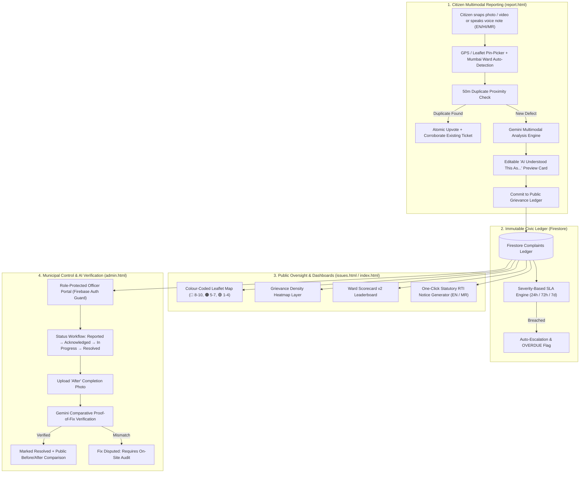
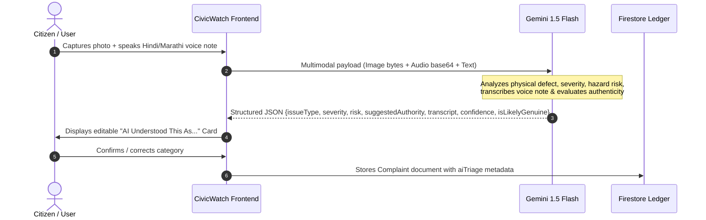

# CivicWatch 2.0: AI-Powered Civic Grievance & Infrastructure Triage Platform

[](https://github.com)
[](https://github.com)
[-orange.svg)](https://github.com)
[](https://deepmind.google/technologies/gemini/)

> **A transparent, multimodal AI-triaged civic infrastructure platform that replaces opaque municipal complaint black-boxes with public accountability, dynamic SLAs, geospatial clustering, and AI-verified proof of fix.**

---

## 🏛️ Problem Statement & Hackathon Alignment

### The Core Problem in Urban Governance
In major metropolitan hubs like Mumbai, millions of citizens encounter hazardous civic infrastructure daily—collapsed road surfaces, overflowing open manholes, contaminated water mains, and accumulated garbage. Traditional complaint portals suffer from:
1. **High Friction Reporting**: Requiring citizens to guess administrative departments and wards or fill tedious multi-page forms.
2. **The "Opaque Black Hole" Effect**: Complaints vanish into closed municipal ticketing systems with zero public visibility into SLAs or delays.
3. **Ghost Resolutions**: Contractors often mark tickets "Resolved" without actually fixing the defect, breeding public cynicism.
4. **Duplicate Fragmentation**: 20 citizens reporting the same dangerous pothole generate 20 duplicate tickets, diluting municipal priority.

### How CivicWatch 2.0 Solves This (IDEA//FORGE Track 1 PS #2)
CivicWatch transforms civic governance into a transparent public ledger:
- **Zero-Friction Multimodal Reporting**: Citizens snap a photo or record a voice note in **Hindi, Marathi, or English**.
- **Gemini Multimodal AI Triage**: Analyzes visual hazards, assigns severity (1–10), classifies safety risk, detects fraudulent memes/screenshots, and routes directly to the correct Brihanmumbai Municipal Corporation (BMC) department.
- **Geospatial Duplicate Clustering**: Proximity detection automatically clusters reports within 50 meters, turning individual complaints into high-priority community upvotes.
- **Dynamic Severity SLAs & Auto-Escalation**: Strict countdown clocks (24h for critical risks, 72h for medium, 7d for routine). Overdue issues auto-escalate up administrative tiers.
- **AI Proof-of-Fix**: Officers must upload an "After" photo. Gemini visual inspection compares the before/after scenes to guarantee the defect was remediated before allowing closure.
- **One-Click RTI Generator**: Citizens can generate statutory Right to Information applications in English & Marathi with one click for overdue complaints.

---

## 🏗️ System Architecture



---

## 🤖 Multimodal AI Triage Pipeline (`ai.js`)



### Structured Output Schema
```json
{
  "issueType": "Open Manhole",
  "severity": 10,
  "severityReason": "Critical fatal fall hazard for pedestrians and two-wheelers, immediate barricading required.",
  "safetyRisk": "high",
  "suggestedAuthority": "BMC Storm Water Drains & Sewerage Operations",
  "transcript": "येथे उघडी गटार आहे, संध्याकाळी कोणाचाही अपघात होऊ शकतो.",
  "englishTranslation": "There is an open manhole here, anyone could have a fatal accident in the evening.",
  "confidence": 0.94,
  "isLikelyGenuine": true,
  "rejectionReason": ""
}
```

---

## ⏱️ Dynamic SLAs & The Accountability Engine

| Severity Level | Turnaround SLA | Typical Issues | Escalation Path |
| :--- | :--- | :--- | :--- |
| **Critical (8–10)** | **24 Hours** | Open Manholes, Mainline Water Bursts, Live Cables | Ward Jr. Engineer → Asst. Municipal Commissioner |
| **Medium (5–7)** | **72 Hours** | Deep Potholes, Solid Waste Overflow, Choked Sewers | Ward Supervisor → Executive Engineer |
| **Routine (1–4)** | **7 Days** | Broken Lampposts, Faded Signage, Minor Debris | Ward Maintenance Squad |

### Ward Scorecard v2 Composite Index
$$\text{Score} = (\text{Resolution Rate} \times 0.40) + (\text{SLA Compliance} \times 0.35) + (\text{Speed Factor} \times 0.15) - (\text{Dispute Penalty} \times 0.10)$$

---

## 🎯 3-Minute Pitch Script for Hackathon Judges

* **0:00 – 0:30 (The Hook & Problem)**:
  "Good afternoon, judges. Today, when a citizen in Mumbai encounters a dangerous open manhole or water leak, reporting it feels like throwing a message in a bottle into an administrative black hole. Tickets disappear, SLAs are ignored, and contractors mark tickets 'Resolved' without lifting a shovel."
* **0:30 – 1:15 (Multimodal AI in Action)**:
  "With CivicWatch, reporting takes 5 seconds. Open `report.html`. A citizen clicks 'Voice Note' and speaks in Marathi or Hindi, or snaps a photo. Watch our Multimodal Gemini engine analyze the scene in real time. It rates the hazard as **Severity 10/10 High Risk**, translates the Marathi voice note into English, and routes it directly to BMC Storm Water Drains. The citizen sees our 'AI Understood This As…' card before submitting."
* **1:15 – 1:55 (Geo-Intelligence & Anti-Duplicate)**:
  "If another citizen reports the same defect 40 meters away, CivicWatch detects the proximity cluster, prompts them to upvote, and merges their evidence into the active ticket—escalating municipal priority instead of spamming the database."
* **1:55 – 2:35 (Public Transparency & AI Proof-of-Fix)**:
  "On `issues.html`, the public sees our interactive Mumbai map with color-coded severity markers, heatmap density hotspots, and live SLA countdowns. Overdue tickets show red breach warnings. When an officer logs into `admin.html` and tries to close the ticket as 'Resolved', our system demands an 'After' completion photo. Gemini compares the before and after images. Only when the AI confirms the hole is filled does the status change to 'Resolved'; otherwise, it is flagged as 'Fix Disputed'."
* **2:35 – 3:00 (Citizen Empowerment & Impact)**:
  "If the municipality delays, citizens have a one-click 'Escalate via RTI' button that auto-drafts a formal Right to Information notice in English and Marathi ready to file. CivicWatch turns every citizen into an empowered auditor of their city's infrastructure."

---

## 🚀 Quickstart & Setup Guide

### 1. Prerequisites
- Modern browser (Chrome / Edge / Firefox)
- Node.js (v18+) or Python 3 for running a local server (no build step required)

### 2. Run Locally
```bash
# Clone the repository
git clone https://github.com/your-username/civicwatch.git
cd civicwatch

# Serve static files on port 8080 (Python or Node)
python -m http.server 8080
# or: npx serve -p 8080 .
```
Open **`http://localhost:8080/index.html`** in your browser.

### 3. Quick Demo Links for Evaluation
- **Homepage & Ward Scorecard**: `http://localhost:8080/index.html`
- **Multimodal Report Form (with Pothole Preset)**: `http://localhost:8080/report.html?preset=pothole`
- **Multimodal Report Form (with Manhole Preset)**: `http://localhost:8080/report.html?preset=manhole`
- **Public Grievance Ledger & Heatmap**: `http://localhost:8080/issues.html`
- **Officer Control Panel (Instant Demo Auth)**: `http://localhost:8080/admin.html?demo=true`
- **AI Proof-of-Fix Resolution Modal**: `http://localhost:8080/admin.html?demo=true&triggerProofOfFix=true`
- **Statutory RTI Draft Generator**: `http://localhost:8080/issues.html?openModal=true`

### 4. Optional: Gemini API Configuration
CivicWatch includes built-in intelligent demo heuristics that work 100% offline. To connect live Gemini API calls:
1. Click the **"⚙️ AI Key"** button in the top navigation bar.
2. Enter your Google AI Studio API key and click **Save Key** (saved securely in your browser's `localStorage`).

---

## 🔒 Security & Firebase Rules
- **Role-Based Access Control**: `admin-guard.js` protects administrative routes, verifying officer credentials against Firestore.
- **XSS & Injection Protection**: Strict DOM sanitization helper (`utils.js`) with input escaping and protocol verification.
- **firestore.rules**: Public read on complaints, schema-validated writes, updates restricted to authenticated municipal officers.
- **storage.rules**: 25MB file upload limit, MIME type matching (`image/*`, `audio/*`, `video/*`).
